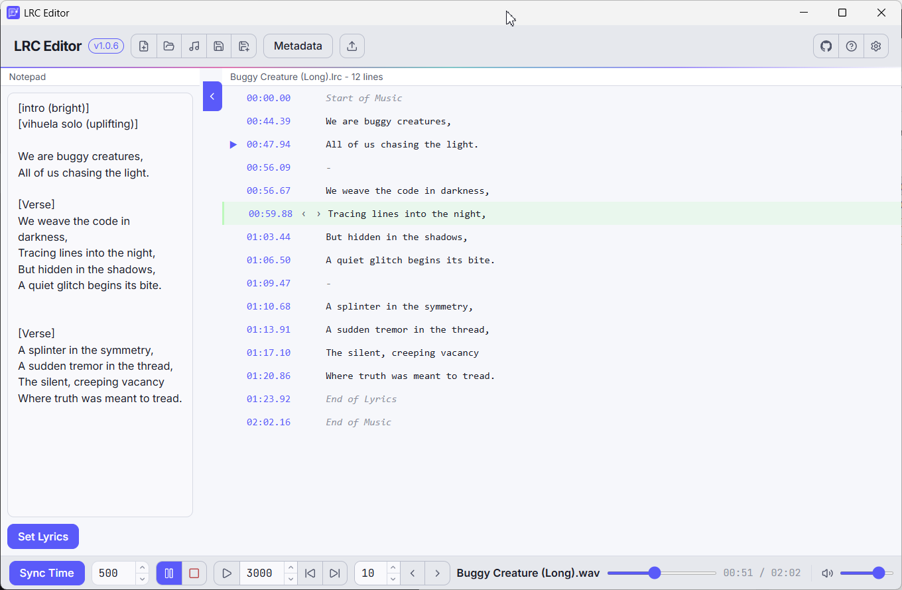

<p align="center">
  
</p>

<h1 align="center">LRC Editor</h1>

<div align="center">
  <strong>One keypress per line. That is the whole sync.</strong><br>
  Create and time-sync <code>.lrc</code> lyric files against the track, with reaction-delay compensation and a hands-free verify pass.
</div>

<br>

<!-- readme:nav -->

<div align="center">
  <a href="../../releases/latest"></a>
  <a href="../../releases"></a>
</div>

<h3 align="center">
  <a href="https://apps.yaiol.com/p/lrc-editor/">Website</a>
  <span>&nbsp;·&nbsp;</span>
  <a href="#install">Install</a>
  <span>&nbsp;·&nbsp;</span>
  <a href="#what-it-is">Features</a>
  <span>&nbsp;·&nbsp;</span>
  <a href="#documentation">Documentation</a>
  <span>&nbsp;·&nbsp;</span>
  <a href="#build-from-source">Development</a>
</h3>

<div align="center">
  <sub><a href="https://apps.yaiol.com/p/lrc-editor/help/"><b>Help in 28 languages</b></a></sub>
</div>

<!-- /readme:nav -->

---

<p align="center">
  
</p>

---

## Install

<div align="center">

<table align="center">
<tr>
<th align="center">Windows</th>
<th align="center">macOS</th>
<th align="center">Linux</th>
</tr>
<tr>
<td align="center"><a href="../../releases/latest"></a></td>
<td align="center"><a href="../../releases/latest"></a></td>
<td align="center"><a href="../../releases/latest"></a></td>
</tr>
<tr>
<td align="center">x64 installer</td>
<td align="center">.dmg, not code-signed</td>
<td align="center">.deb and AppImage</td>
</tr>
</table>

</div>

> **Windows note:** SmartScreen may warn on first launch because the app is not code-signed. Click "More info", then "Run anyway".

---

## What it is

`.lrc` files are what make lyrics scroll in sync with a song in music players and karaoke apps. Producing them by hand is tedious: every line needs an accurate timestamp.

LRC Editor turns that into a single-keypress flow. Load a track, get your lyric lines into the editor, then press one key on each line as the song plays - the current playback position is stamped on the spot, and the selection advances automatically. A built-in reaction-delay compensation corrects for the gap between hearing a line and pressing the key, and a hands-free Verify pass plays the finished file back so you can catch any stamp that drifted.

---

## Features

- **Real-time sync** - stamp the current playback position onto a lyric line with a single keypress.
- **Reaction-delay compensation** - subtract a configurable delay to correct for human response time.
- **Verify pass** - play the finished file back hands-free, auto-advancing through every line to catch stamps that land early or late.
- **Time nudge and global offset** - shift individual lines in configurable millisecond steps, or the whole file at once via the LRC offset tag.
- **Reads your files** - import `.lrc` and `.txt`, export `.lrc` and plain `.txt`, and auto-load a matching `.lrc` when you open an audio file.
- **Reads your tags** - title, artist, album and duration straight from the audio (mp3, flac, m4a, and more).
- **Notepad panel** - paste raw lyrics, then bulk-import them into the editor in one click.
- Undo / redo with a 50-level stack, dark and light themes, 3 fonts, and dozens of interface languages including RTL and CJK scripts.

---

## Documentation

| | |
|---|---|
| **User manual** | [Read it online](https://apps.yaiol.com/p/lrc-editor/help/) |
| **Printable PDF** | attached to each [release](../../releases/latest) |
| **What's new** | [Release notes](https://apps.yaiol.com/p/lrc-editor/help/releases/) |
| **Product page** | [apps.yaiol.com](https://apps.yaiol.com/p/lrc-editor/) |

---

## Build from source

Requires the Rust toolchain (stable) and, for the installer, the Dioxus CLI (`cargo install dioxus-cli`).

```bash
cargo run                                         # run in development
cd app && dx bundle --desktop --release --package-types nsis   # Windows installer → release/
```

---

## Architecture

A Cargo workspace of two crates:

- `engine/` — everything that is not the window: the LRC format and its timing rules, reading a song's
  tags, and a small local server that feeds the song to the player (with byte ranges, so seeking works)
  and lets a second launch open its file in the window already running. No UI dependency.
- `app/` — the Dioxus desktop shell. The look comes from the shared stylesheet in `app/assets/`;
  strings come from `locales/<lang>.json`, embedded in the executable at build time.

---

## License

Released under the [MIT License](LICENSE).

<div align="center">
  <sub>LRC Editor is part of <a href="https://apps.yaiol.com">yaiol Applications</a>.</sub>
</div>
